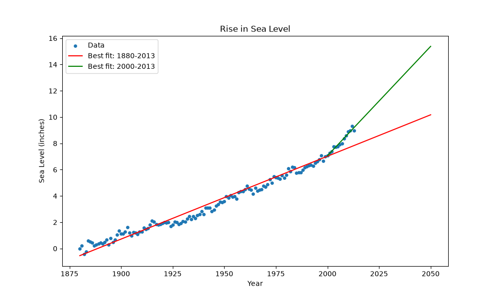

# Sea Level Predictor

A Python, Pandas, Matplotlib and SciPy project by **Junot Cacoq** for the freeCodeCamp Data Analysis with Python curriculum.

It uses historical sea level data (1880-2013) to draw a scatter plot and two lines of best fit that predict the sea level rise until the year 2050.

## Chart

The chart is saved in the project folder as `sea_level_plot.png` every time `draw_plot()` runs, wherever you start Python from.



## Results

| Line of best fit | Data used | Rise per year | Predicted sea level in 2050 |
| --- | --- | --- | --- |
| Red | All years (1880-2013) | 0.063 inches | 10.18 inches |
| Green | Years from 2000 onward | 0.166 inches | 15.38 inches |

The rise since 2000 is about 2.6 times faster than the long-term trend. Predictions are straight-line extrapolations of the dataset, not scientific forecasts.

## Dataset

`epa-sea-level.csv` has 134 yearly records. This project uses the `Year` and `CSIRO Adjusted Sea Level` columns (in inches).

## Project files

| File | Purpose |
| --- | --- |
| `sea_level_predictor.py` | Reads the data, draws the chart and saves it. |
| `epa-sea-level.csv` | Input dataset. |
| `main.py` | Draws the chart and runs the tests. |
| `test_module.py` | Unit tests for the chart and the saved image. |
| `requirements.txt` | Python dependencies. |

## Installation

```bash
git clone https://github.com/junot10-cpu/fcc-sea-level-predictor.git
cd fcc-sea-level-predictor
python3 -m pip install -r requirements.txt
```

## Run the project

```bash
python3 main.py
```

This creates `sea_level_plot.png` in the project folder and runs the 6 tests.

## Testing

The tests are based on the freeCodeCamp project tests (title, labels, data points and both lines of best fit). Two tests were added to confirm that the image is saved in the project folder and that both lines reach 2050. `draw_plot()` returns the chart axes, which is what the tests expect.

## References

- [freeCodeCamp project instructions](https://www.freecodecamp.org/learn/data-analysis-with-python/data-analysis-with-python-projects/sea-level-predictor)
- [freeCodeCamp starter template](https://github.com/freeCodeCamp/boilerplate-sea-level-predictor)

## Author

**Junot Cacoq** · [GitHub](https://github.com/junot10-cpu)
